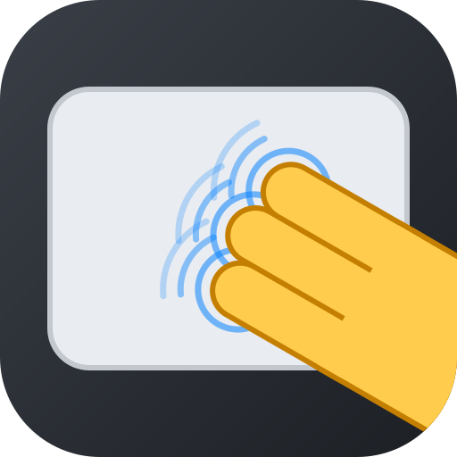

<p align="center"></p>

# macpad-x11

macOS-style touchpad gestures for Linux on X11.

[日本語](README.ja.md)

- **Three-finger drag.** Swipe with three fingers to drag windows, files or
  text selections. Lift your fingers briefly and put them back to continue
  the same drag, just like on a Mac. Move the pointer with one finger, click
  or scroll to end it immediately.
- **Pinch to zoom around the pointer.** The point under the pointer stays
  put while you zoom, and moving your fingers while pinching pans — in
  Chrome and other Chromium/Electron apps this is smooth, native zoom, even
  though Chrome on X11 ignores touchpad pinches. Other apps are driven with
  wheel clicks or keys; [apps.ini](apps.ini) says which, and you can add
  your own apps without touching any code.
- One small Python script. No compilation, no root daemon, no fusuma or
  touchegg needed.

macpad-x11 was called three-finger-drag before it learned to pinch.

## Requirements

- An **X11** session (Wayland is not supported)
- Python 3.8 or later (standard library only)
- `libinput` (the `libinput debug-events` command — on Debian/Ubuntu it is in
  the `libinput-tools` package)
- `libX11` and `libXtst` (`libx11 libxtst` on Arch, `libx11-6 libxtst6` on
  Debian/Ubuntu, `libX11 libXtst` on Fedora)
- Your user in the `input` group (to read the touchpad and to create the
  virtual touchscreen used for pinch zoom):

  ```sh
  sudo gpasswd -a "$USER" input   # then log out and back in
  ```

## Install

### Arch Linux / Manjaro

Build and install a pacman package with the bundled `PKGBUILD`:

```sh
git clone https://github.com/yuba/macpad-x11.git
cd macpad-x11
makepkg -si
systemctl --user start macpad-x11.service   # or just log in again
```

`makepkg` downloads the tagged release and installs the dependencies. The
package replaces three-finger-drag. Uninstall with `sudo pacman -R macpad-x11`.

### Debian / Ubuntu

Download `macpad-x11_*_all.deb` from the
[latest release](https://github.com/yuba/macpad-x11/releases/latest), then:

```sh
sudo apt install ./macpad-x11_*_all.deb
systemctl --user start macpad-x11.service   # or just log in again
```

Debian 12 or later, Ubuntu 20.04 or later. Uninstall with
`sudo apt remove macpad-x11`.

### Fedora

Download `macpad-x11-*.noarch.rpm` from the
[latest release](https://github.com/yuba/macpad-x11/releases/latest), then:

```sh
sudo dnf install ./macpad-x11-*.noarch.rpm
systemctl --user start macpad-x11.service   # or just log in again
```

Uninstall with `sudo dnf remove macpad-x11`.

### Any distribution

```sh
git clone https://github.com/yuba/macpad-x11.git
cd macpad-x11
./install.sh
```

This installs into `~/.local`, registers a systemd user service and an XDG
autostart entry, and starts the daemon. To remove macpad-x11:

```sh
./install.sh --uninstall
```

## Configuration

`~/.config/macpad-x11/config.ini` — every setting is optional; see
[config.example.ini](config.example.ini) for all of them.

```ini
[drag]
timeout = 0.5      ; grace period (s) after lifting the fingers
speed = 3.0        ; pointer movement per unit of swipe movement

[pinch]
enabled = yes

[app Some-app]     ; WM_CLASS class or instance name; overrides apps.ini
zoom = wheel
modifier = ctrl
step = 1.1
pan = wheel
```

Apply changes with `systemctl --user reload macpad-x11.service`.

## Pinch zoom and apps.ini

What zooms an app around the pointer differs from app to app, so
[apps.ini](apps.ini) lists, per WM_CLASS, which of a few generic methods to
use:

| `zoom`  | what macpad-x11 sends                                        | good for                          |
|---------|--------------------------------------------------------------|-----------------------------------|
| `touch` | a two-finger pinch on a virtual touchscreen, one finger on the pointer | Chromium, Electron, some GTK apps: smooth, and pans too |
| `wheel` | wheel clicks at the pointer, with `modifier` held             | apps whose (Ctrl+)wheel zooms at the pointer |
| `keys`  | `zoom_in` / `zoom_out` key presses                            | the fallback; zooms around the app's own center |
| `none`  | nothing                                                       | apps that handle pinches themselves |

With `wheel` and `keys`, `step` is the app's zoom factor per click or key
press, and `pan = wheel` pans with wheel clicks while you pinch. Apps not
listed get `[pinch.default]` (`zoom = keys`).

`[app NAME]` sections are matched against both parts of WM_CLASS (class and
instance name), ignoring case, and NAME may be a glob, so `[app vivaldi*]`
covers both the native and the Flatpak build. A section with
`requires_env = NAME=VALUE` applies only to processes that have that
environment variable.

### Supported apps

Measured with `tools/probe` (October 2026):

| | zoom around the pointer | pans while pinching |
|---|---|---|
| Chrome, Chromium, Brave, Edge | smooth (`touch`) | yes |
| Vivaldi | smooth (`touch`), anchor slightly off | untested |
| Firefox | smooth (`touch`) — see below | untested |
| GIMP, Inkscape, Krita, Eye of GNOME | smooth (`touch`) | untested |
| Evince | in steps (`wheel`) | yes |
| Gwenview | in steps (`keys`) | yes |
| Papers, Xournal++, Ristretto, Viewnior, gThumb, nomacs, Loupe | in steps (`wheel`) | no |
| mpv | in steps (`wheel`), anchor slightly off | no |
| zathura | zooms, but around the view (`wheel`) | no |

**Firefox** handles touchscreen pinches only when it runs with
`MOZ_USE_XINPUT2=1` in its environment, so set it, for example with
`export MOZ_USE_XINPUT2=1` in `~/.xprofile`. macpad-x11 checks the variable
in each Firefox process (the `requires_env` key of an entry) and uses keys
for a Firefox started without it.

Not supported yet: Okular, LibreOffice and KolourPaint have no
pointer-anchored zoom that macpad-x11 can trigger; VS Code and other
Electron apps disable pinch zoom; Pinta cannot be told apart by its WM_CLASS
(`dotnet`). They get the default `keys`.

### Adding an app

`tools/probe` finds the right entry for you. It needs xdotool, ImageMagick
and Python with numpy and OpenCV:

```sh
python3 -m venv .venv && .venv/bin/pip install numpy opencv-python-headless
tools/make-testdata                 # grid documents in testdata/
# open testdata/grid.{png,pdf,svg,html} in the app, then:
.venv/bin/python tools/probe -o probe.png
# point at the app's window within 3 seconds
```

It tries every method with synthetic pinches (your touchpad and the running
service are not involved), measures how far the content moved, and prints
an entry to paste into your config or into apps.ini. Close welcome and
other dialogs first, and look at the contact sheet: a document that is too
plain to match can fool the measurement. Never set `zoom = touch` for an
app that does not zoom on touchscreen pinches — X then turns the virtual
fingers into a mouse drag. Pull requests that add apps are very welcome —
please attach the `probe.png` contact sheet.

## Conflicts

Disable other bindings for three-finger swipes and two-finger pinches
(fusuma, touchegg, libinput-gestures, your desktop's own gestures);
otherwise both will act on the same gesture.

## How it works

The daemon reads `libinput debug-events`.

**Drag.** A tiny state machine: a three-finger `GESTURE_SWIPE_BEGIN` presses
the left button via XTest, updates move the pointer, `GESTURE_SWIPE_END`
starts the grace period with the button still held. Another swipe continues
the drag; `POINTER_MOTION`, a click, a scroll or a pinch releases it at once;
otherwise it is released when the grace period ends. The daemon must stay
resident because libinput ignores touches that were already on the touchpad
when it started, and it reacts to libinput events rather than polling the
cursor: when you lift two of three fingers, the remaining finger's
`POINTER_MOTION` arrives about 4 ms later and the button is released right
there, so the object is not dragged along.

**Pinch.** At `GESTURE_PINCH_BEGIN` the daemon looks up the WM_CLASS of the
window under the pointer. For `touch` it replays the pinch on a uinput
touchscreen: the first finger stays on the pointer and the second moves with
the pinch scale. In a touch pinch the content follows the fingers, so the
point under the first finger — the pointer — stays put, and because X moves
the cursor to the first touch, the cursor does not jump either. Moving your
fingers moves both virtual fingers, which pans. Small pinches start only
after a short distance, since apps take a short two-finger touch for a
right-click.

## Troubleshooting

```sh
systemctl --user status macpad-x11.service
journalctl --user -u macpad-x11.service
```

If the button ever seems stuck, `systemctl --user restart macpad-x11.service`
releases it.

## License

MIT
